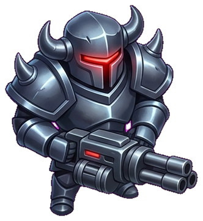
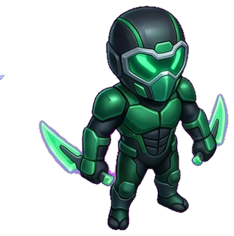

<div align="center">


# ApexShock: Solaris Rift

**Fast-Paced 3v3 Sci-Fi / Solar-Punk Hero Arena Brawler for Mobile**

[](https://godotengine.org)
[](https://github.com/BiosSystem/ApexShock/releases/latest)
[](https://github.com/BiosSystem/ApexShock)
[](https://github.com/BiosSystem/ApexShock/releases/tag/v0.3.0)
[](LICENSE)

<br/>

### 📱 [**Download Latest Android APK (v0.3.0)**](https://github.com/BiosSystem/ApexShock/releases/download/v0.3.0/ApexShock-v0.3.0.apk) &nbsp;•&nbsp; 💻 [**Desktop Playtest Bundle (.zip)**](https://github.com/BiosSystem/ApexShock/releases/download/v0.3.0/ApexShock-v0.3.0-Bundle.zip) &nbsp;•&nbsp; 📖 [**Sideloading Guide**](docs/SIDELOAD_GUIDE.md)

</div>

---

## ⚡ Overview

**ApexShock: Solaris Rift** is a competitive top-down mobile hero arena brawler engineered for maximum responsiveness, tactical skill expression, and fluid 60 FPS combat. Compete in high-stakes 3v3 team skirmishes and survival showdowns across the radiant **Solaris Rift Courtyard**, seizing dynamic cover, activating active tactical gadgets, and unleashing game-changing **Max-Tier Overdrive Transformations**.

<div align="center">
  
  <p><em>Real-time 3v3 arena combat with dual virtual sticks, responsive safe-area HUD, and neon Overdrive effects.</em></p>
</div>

---

## 🚀 Key Features

- **🏆 3v3 Tactical Arena & Showdown Modes**: Battle for control of the 3,000 HP Aegis Reactor Core, secure solar crystal pick-ups, and utilize bioluminescent stealth flora to ambush opposing champions.
- **🛡️ Six Original 3D Vanguard Heroes**: Master diverse combat specializations ranging from frontline kinetic brawlers and long-range solar marksmen to magma siege artillery.
- **🔥 4-Tier Combat Hierarchy**: Elevate beyond standard shooting with directional primary fire, emerald Active Gadgets (3 charges/match), Star Passives, and the tide-turning **Overdrive Surge**.
- **⚡ Max-Tier Overdrive Transformation**: Build your Overdrive gauge to ignite a 5-second high-voltage surge delivering **+25% Movement Speed**, **+25% Attack Damage**, **+20% Phase Shield**, and a blazing purple lightning aura.
- **📱 True Mobile-First Architecture**: Built on Godot 4.3 with the Vulkan Mobile pipeline, notch/punch-hole safe-area adaptation (`SafeAreaContainer`), zero-allocation memory pooling to prevent GC frame-drops, and dual-stick touch ergonomics.

---

## 👥 The Vanguard Roster

<div align="center">
  
</div>

| Hero | Archetype | Vitality | Signature Weapon & Super Ability |
| :---: | :---: | :---: | :--- |
| <br/>**Volt** | Kinetic Shock Tank | **4,200 HP** | **Twin Arc-Gauntlets**: Close-range electric shockwaves.<br/>*Super*: **Thunderbolt Meteor Leap** (AoE ground slam & knockback). |
| <br/>**Valkyrie** | Solar Marksman | **3,600 HP** | **Twin-Rail Sun-Lance**: Long-range piercing beam rifle.<br/>*Super*: **Supernova Piercing Volley** (Wall-penetrating energy beam). |
| <br/>**Cinder** | Magma Artillery | **3,000 HP** | **Brass Magma Mortar**: Parabolic explosive shells lobbed over cover.<br/>*Super*: **Volcanic Eruption** (Area denial lava pool barrage). |
| <br/>**Bastion** | Siege Juggernaut | **5,200 HP** | **Tri-Barrel Sonic Scatter**: High-spread shotgun cone.<br/>*Super*: **Aegis Barrier Dome** (Deployable 2,500 HP defensive bubble). |
| <br/>**Tesla** | Arc Technomancer | **3,400 HP** | **Chain-Lightning Staff**: Arcing electricity hitting multiple targets.<br/>*Super*: **Overcharge Pylon** (Automated perimeter shock turret). |
| <br/>**Phantom** | Void Skirmisher | **3,400 HP** | **Dual Phase Daggers**: Rapid melee strikes with stealth bonuses.<br/>*Super*: **Void Blink Ambush** (Instant flank teleport + invisibility). |

*Explore full ability cooldowns, damage curves, and passive traits in the [Hero Roster Documentation](docs/HERO_ROSTER.md).*

---

## 📥 Direct Downloads & Quick Start

### Android Sideloading (Phones & Tablets)
1. Download [**`ApexShock-v0.3.0.apk`**](https://github.com/BiosSystem/ApexShock/releases/download/v0.3.0/ApexShock-v0.3.0.apk) directly onto your mobile device.
2. Tap the downloaded file and select **Install** (allow unknown sources if prompted by Android).
3. Open **ApexShock** from your home screen and jump into the arena.

*Prefer installing from your PC? Connect via USB and run:*
```bash
adb install -r ApexShock-v0.3.0.apk
```

### Desktop / Workstation Playtest
1. Download [**`ApexShock-v0.3.0-Bundle.zip`**](https://github.com/BiosSystem/ApexShock/releases/download/v0.3.0/ApexShock-v0.3.0-Bundle.zip) and unzip.
2. Launch with Godot 4.3:
   ```bash
   godot --main-pack ApexShock-v0.3.0.pck
   ```

*Detailed installation and troubleshooting steps are available in the [Sideloading Guide](docs/SIDELOAD_GUIDE.md).*

---

## ⚙️ Target Specifications & System Requirements

| Parameter | Recommended Specification | Minimum Specification |
| :--- | :--- | :--- |
| **Operating System** | Android 11.0 through Android 15 | Android 8.0 (Oreo) |
| **Processor & Architecture** | 64-bit ARM (ARM64-v8a) | 64-bit ARM (ARM64-v8a) |
| **Graphics API** | Vulkan 1.2+ Mobile Support | Vulkan 1.0 Mobile Support |
| **RAM** | 4 GB or higher | 2 GB |
| **Storage** | 100 MB free space | 60 MB free space |
| **Frame Rate** | Locked 60 FPS | 60 FPS |

---

## 🔒 Security & Release Verification (v0.3.0)

All game logic in official release builds is compiled into stripped bytecode to ensure runtime execution efficiency and package integrity:

| Artifact | Size | SHA-256 Checksum |
| :--- | :---: | :--- |
| **`ApexShock-v0.3.0.apk`** | `28.56 MB` | `c61fce1f8c43ce5e53a9b8bb6227ac9488c3fc479cb91279c3a8f5c1c750f229` |
| **`ApexShock-v0.3.0.pck`** | `4.27 MB` | `6481ca00bfa0af3f0d9f20f721c8c664c386cbe8eec144affa9dcff08c157e35` |
| **`ApexShock-v0.3.0-Bundle.zip`** | `32.49 MB` | `6e0cd21506330c35804847e6ee5e206ea2c8e1f03d7e1f8b19ebec950359bc2b` |

---

## 💬 Community, Feedback & Issues

- Have a balance recommendation or bug report? Open an issue on our [Issue Tracker](https://github.com/BiosSystem/ApexShock/issues).
- Hosted and maintained by [BiosSystem](https://bios-system.net).
- Licensed under the [MIT License](LICENSE).
