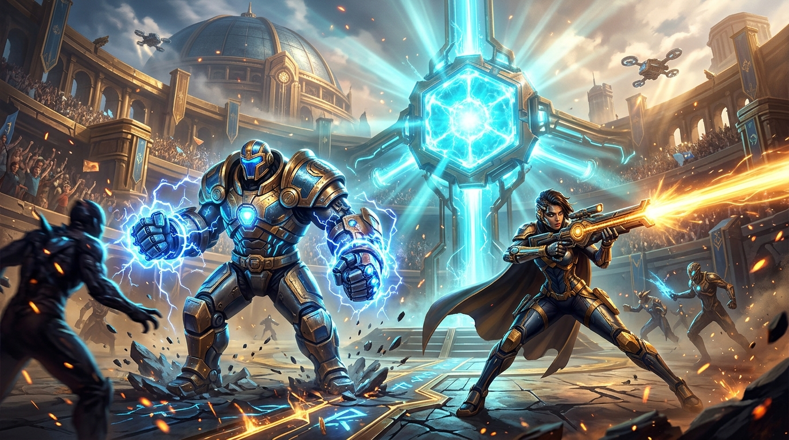
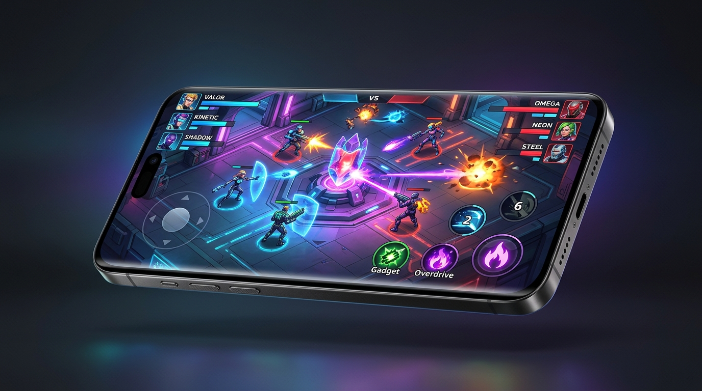
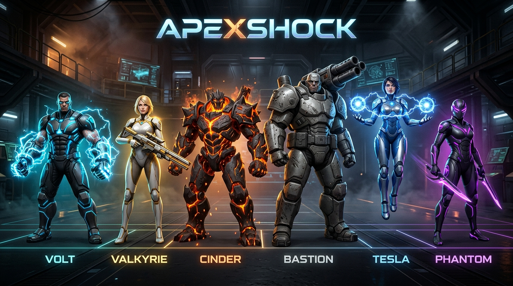

<div align="center">



# ApexShock: Solaris Rift

Top-down 3v3 sci-fi mobile hero arena brawler built for Android.

[](https://godotengine.org)
[](https://github.com/BiosSystem/ApexShock/releases/latest)
[](https://github.com/BiosSystem/ApexShock)
[](https://github.com/BiosSystem/ApexShock/releases/tag/v0.3.0)
[](LICENSE)

<br/>

| Package | Platform | Target Architecture | Download Link |
|---|---|---|---|
| **Android APK** | Android 8.0+ | ARM64-v8a | [ApexShock-v0.3.0.apk](https://github.com/BiosSystem/ApexShock/releases/download/v0.3.0/ApexShock-v0.3.0.apk) (28.56 MB) |
| **Desktop Playtest** | Windows 10/11 x64 | x86_64 | [ApexShock-v0.3.0-Bundle.zip](https://github.com/BiosSystem/ApexShock/releases/download/v0.3.0/ApexShock-v0.3.0-Bundle.zip) (32.49 MB) |
| **Bytecode Pack** | Cross-platform Godot 4.3 | Any | [ApexShock-v0.3.0.pck](https://github.com/BiosSystem/ApexShock/releases/download/v0.3.0/ApexShock-v0.3.0.pck) (4.27 MB) |

[Installation Guide](docs/SIDELOAD_GUIDE.md) | [Hero Roster & Ability Specs](docs/HERO_ROSTER.md) | [Report an Issue](https://github.com/BiosSystem/ApexShock/issues)

</div>

---

## Overview

ApexShock is a fast-paced top-down hero arena brawler designed natively for mobile touch controls. Two teams of three compete inside the Solaris Rift Courtyard to destroy the opponent's Aegis Reactor Core, capture contested territory, and eliminate enemy champions.

The project is built on Godot 4.3 using the Vulkan Mobile rendering pipeline, custom zero-allocation memory pools (`ObjectPool`), and safe-area margin containers (`SafeAreaContainer`) to support notched displays and hardware camera cutouts.

<div align="center">
  
  <p><em>In-game combat preview showing dual touch joysticks, Overdrive meter, and objective telemetry.</em></p>
</div>

---

## Combat Mechanics

### 4-Tier Ability Architecture
1. **Primary Fire**: Directional attacks aimed with the right virtual touch joystick or mouse cursor.
2. **Active Gadgets**: Two selectable secondary tools per hero (3 charges per match, 5.0-second cooldown). Triggered via the gadget button or keyboard `[G]`.
3. **Star Passives**: Permanent tactical stat and trait modifiers selected in the pre-match armory.
4. **Overdrive Surge**: Building combat energy unlocks a 5.0-second high-voltage state granting +25% movement speed, +25% attack damage, +20% phase shield, and an electrical damage aura. Triggered via the Overdrive button or keyboard `[H]`.

### Arena Objectives & Environmental Cover
- **Aegis Reactor Core**: 3,000 HP primary team objective structure located at the top center of the courtyard. Team integrity telemetry tracks remaining core health in real time.
- **Dynamic Cover**: Destructible alloy supply crates and reinforced energy barriers allow heroes to break projectile line of sight.
- **Bioluminescent Flora**: Dense stealth patches grant complete line-of-sight concealment to ambush advancing opponents.

---

## Vanguard Hero Roster

<div align="center">
  
</div>

| Hero | Archetype | Vitality | Weapon Signature | Super Ability |
|---|---|---|---|---|
| **Volt** | Kinetic Tank | 4,200 HP | Twin Arc-Gauntlets (close-range shockwaves) | **Thunderbolt Meteor Leap**: AoE ground slam and knockback |
| **Valkyrie** | Solar Marksman | 3,600 HP | Twin-Rail Sun-Lance (high-velocity beam rifle) | **Supernova Piercing Volley**: Wall-penetrating line projectile |
| **Cinder** | Magma Artillery | 3,000 HP | Brass Magma Mortar (parabolic explosive shells) | **Volcanic Eruption**: Area-denial lingering lava pools |
| **Bastion** | Siege Juggernaut | 5,200 HP | Tri-Barrel Sonic Scatter (wide shotgun spread) | **Aegis Barrier Dome**: Deployable 2,500 HP defensive bubble |
| **Tesla** | Arc Technomancer | 3,400 HP | Chain-Lightning Staff (arcing electrical damage) | **Overcharge Pylon**: Automated perimeter attack turret |
| **Phantom** | Void Skirmisher | 3,400 HP | Dual Phase Daggers (rapid melee attacks) | **Void Blink Ambush**: Flank teleport with 2-second stealth |

Detailed damage formulas, passive descriptions, and balance tables are documented in [docs/HERO_ROSTER.md](docs/HERO_ROSTER.md).

---

## Installation & Sideloading

### Direct Android Sideloading (Phones & Tablets)
1. Download [ApexShock-v0.3.0.apk](https://github.com/BiosSystem/ApexShock/releases/download/v0.3.0/ApexShock-v0.3.0.apk) to your Android device.
2. Tap the APK file and select **Install**. If prompted, grant permission to install from your browser or file manager.
3. Launch **ApexShock** from your applications menu.

### Sideloading via ADB (Workstation to Device)
With your Android device connected via USB with USB Debugging enabled:

```bash
adb install -r ApexShock-v0.3.0.apk
```

### Desktop Playtest (Windows x64)
1. Download and extract [ApexShock-v0.3.0-Bundle.zip](https://github.com/BiosSystem/ApexShock/releases/download/v0.3.0/ApexShock-v0.3.0-Bundle.zip).
2. Execute with any Godot 4.3 binary:
   ```bash
   godot --main-pack ApexShock-v0.3.0.pck
   ```

Desktop controls: Move with `W`/`A`/`S`/`D`, aim and shoot with Mouse Left-Click, Gadget on `[G]`, Overdrive on `[H]`, Menu on `[TAB]`. Full controller support via standard XInput/DirectInput gamepads.

---

## System Requirements

| Specification | Minimum | Recommended |
|---|---|---|
| **Operating System** | Android 8.0 (Oreo) | Android 11.0 or newer |
| **Architecture** | 64-bit ARM (ARM64-v8a) | 64-bit ARM (ARM64-v8a) |
| **Graphics API** | Vulkan 1.0 Mobile | Vulkan 1.2+ Mobile |
| **Memory (RAM)** | 2 GB | 4 GB or higher |
| **Storage** | 60 MB free space | 100 MB free space |
| **Target Refresh Rate** | 60 FPS | 60 FPS locked |

---

## Package Verification & Checksums

Release binaries are compiled with stripped GDScript bytecode (`.gdc`):

| Artifact | Size | SHA-256 Checksum |
|---|---|---|
| `ApexShock-v0.3.0.apk` | 28.56 MB | `c61fce1f8c43ce5e53a9b8bb6227ac9488c3fc479cb91279c3a8f5c1c750f229` |
| `ApexShock-v0.3.0.pck` | 4.27 MB | `6481ca00bfa0af3f0d9f20f721c8c664c386cbe8eec144affa9dcff08c157e35` |
| `ApexShock-v0.3.0-Bundle.zip` | 32.49 MB | `6e0cd21506330c35804847e6ee5e206ea2c8e1f03d7e1f8b19ebec950359bc2b` |

---

## License & Community

- **License**: Released under the [MIT License](LICENSE).
- **Bug Reports & Balance Feedback**: Open a ticket on the [GitHub Issues](https://github.com/BiosSystem/ApexShock/issues) page.
- **Publisher**: Hosted and distributed by [BiosSystem](https://bios-system.net).
