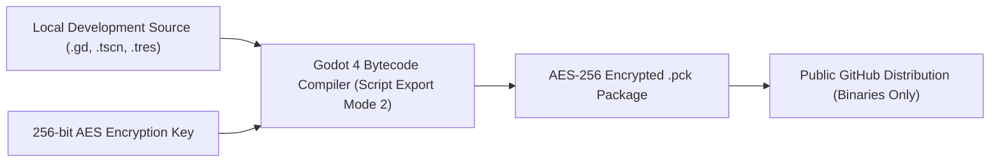

# Security & Intellectual Property Protection Policy

## 1. Security Architecture & Threat Model

ApexShock employs a multi-layered security and anti-reverse-engineering model designed to protect proprietary balance algorithms, original champion assets, network protocols, and game code against unauthorized decompilation, automated scraping, and artificial intelligence model training.

---

## 2. Anti-AI Reverse Engineering & Scraping Protections

### Machine-Readable Opt-Outs
- **Robots Exclusion**: All public entry points carry `robots.txt` directives disallowing known generative AI crawlers (including `GPTBot`, `ClaudeBot`, `CCBot`, `Bytespider`, `Google-Extended`, `PerplexityBot`, `Diffbot`, and `FacebookBot`).
- **TDM Reservation**: Pursuant to Article 4(3) of Directive (EU) 2019/790 on copyright in the Digital Single Market, BiosSystem expressly reserves all rights regarding text and data mining across all repository contents, documentation, binary packages, and schemas (`.well-known/ai.txt`).

### Binary & Source Code Protection
1. **Source Air-Gap**: The complete GDScript game source code, scenes, shaders, and unit test suites are permanently air-gapped on private development workstations. No raw `.gd` source code is published to public git trees.
2. **Bytecode Tokenization**: Release packages strip all developer comments, internal identifiers, and source strings (`script_export_mode=2`), emitting compiled `.gdc` bytecode.
3. **AES-256 Bytecode & PCK Encryption**: PCK package headers, directory structures, and code assets are encrypted with a 256-bit AES cryptographic key, blocking off-the-shelf Godot decompilers (`gdsdecomp`, `RE-Tools`).
4. **Authoritative Server Isolation**: All authoritative combat resolution, damage formulas, hit validation, and spatial boundaries execute strictly on headless dedicated server instances (`--server`). The client package contains zero simulation authority, eliminating client-side game logic exfiltration.
5. **Canary Provenance Tokens**: Forensic watermark tokens (`BIOS-MG-SEC-7702-CANARY`) are embedded into binary metadata to detect unauthorized inclusion in AI training datasets or derivative forks.

---

## 3. License & Acceptable Use Restrictions

Any crawling, scraping, automated tokenization, decompilation, memory dumping, or ingestion of ApexShock assets or binaries into neural network models, large language models (LLMs), or machine learning training sets is strictly prohibited without explicit written authorization from BiosSystem.

---

## 4. Coordinated Vulnerability Disclosure

If you discover a security vulnerability or bypass in the release binaries or network protocol, report it privately to the BiosSystem security team. Do not open public issues.
